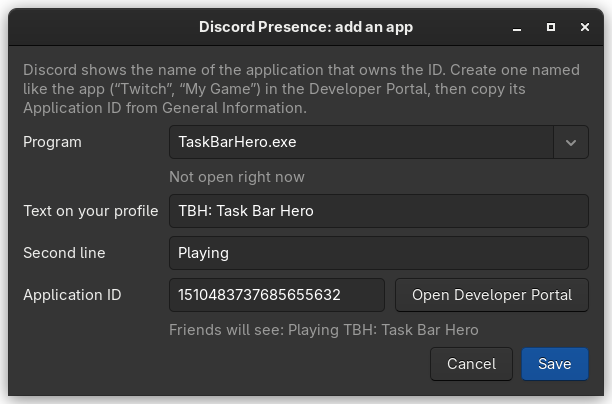

# Discord Arrpc Detector KDE

**Discord Rich Presence for the games and apps Discord ignores on Linux.**
Native games, games under Proton, Counter-Strike 2 with map and score,
Minecraft with the server you are on, YouTube, YouTube Music, Twitch, Netflix,
Crunchyroll and Spotify playing in your browser, Stremio, and any program you
point it at.

[Português](README.pt-BR.md) · [Releases](https://github.com/gabrielmf1998/Discord-Arrpc-Detector-KDE/releases) · [Report a problem](https://github.com/gabrielmf1998/Discord-Arrpc-Detector-KDE/issues/new/choose) · [GitLab mirror](https://gitlab.com/gabriel17166/discord-arrpc-detector-kde)

A small daemon written in plain Python (standard library only) finds the
processes and media players, then talks to Discord's own IPC socket. It runs
as a systemd user service and comes with a tray icon for everything else. It
works with Vesktop and with the official Discord app, on any desktop; KDE
Plasma gets a few extras (window titles for browser tabs, accent color icon).



---

## Why

Discord detects games by matching running processes against its public list of
detectable games. On Linux that list fails in several ways at once:

| Situation | What Discord's list has | Result |
|---|---|---|
| RuneScape native (`rs2client`) | only `win32` and `darwin` executables | never detected |
| GTA SA under Proton (`gta-sa.exe`) | a `win32` path | the process has a Wine path, no match |
| TBH: Task Bar Hero | **no** executable at all | never detected |
| YouTube, Twitch, Netflix, Stremio... | not in the list | never detected |

This project goes the other way around: it knows which process is which app
and publishes the presence itself.

## What it shows

| App | How it is detected | What friends see |
|---|---|---|
| **Counter-Strike 2** | `cs2` process + Valve's Game State Integration | mode and map ("Competitivo · Mirage"), **your team's score**, your K/A/D, warmup, end of match |
| **Minecraft** (Prism, MultiMC, Flatpak) | the instance's `java` | instance name, **server you joined** (as you typed it) and **player count** (`860 of 5000`) |
| **Left 4 Dead 2** | `hl2_linux -game left4dead2` or `left4dead2.exe` | **campaign and chapter** |
| **GTA: San Andreas** | reads the game's memory (read only) | **neighborhood, vehicle, health, money**, wanted level, "on a mission" |
| **Roblox** (Sober) | `sober` process | **experience name**, creator, icon, player count |
| **RuneScape 3**, **TBH: Task Bar Hero** | process name | the game, with play time |
| **YouTube** (Firefox, Chrome, Chromium, Brave, Vivaldi, Edge) | MPRIS + the browser tab | **title and channel** with links, thumbnail, progress bar, paused, **live**, **Shorts**, ads, and the page you browse |
| **YouTube Music** | MPRIS + the browser tab | **track and artist**, cover, progress, paused |
| **Twitch** | MPRIS + the browser tab | **channel** and stream title, link to the channel |
| **Netflix**, **Crunchyroll** | MPRIS + the browser tab | what is playing (when the page tells), paused, progress |
| **Spotify Web** | MPRIS + the browser tab | **track and artist**, cover, progress |
| **Stremio** | process + MPRIS | **series and episode** |
| **Claude Code** | executable name | "Programming" and session time, nothing else |
| **Anything else** | the tray's **Add your own app** window | your text, your Application ID |

Twitch, Netflix, Crunchyroll and Spotify are not in Discord's list, so each one
needs a Discord application of your own (two minutes, see
[Sites that need your Application ID](#sites-that-need-your-application-id)).
Until then they stay off.

---

## Install

### Script (any distro with systemd)

Run it as your normal user; `sudo` only shows up when a dependency is missing.

```bash
curl -fsSL https://raw.githubusercontent.com/gabrielmf1998/Discord-Arrpc-Detector-KDE/main/install.sh | bash
```

Options go **after the pipe**:

```bash
URL=https://raw.githubusercontent.com/gabrielmf1998/Discord-Arrpc-Detector-KDE/main/install.sh
curl -fsSL "$URL" | SKIP_VESKTOP=1 bash       # you already use a client with the IPC socket
curl -fsSL "$URL" | SKIP_TRAY=1 bash          # no tray icon
curl -fsSL "$URL" | DGP_VERSION=1.5.0 bash    # a specific version
```

Everything from the GitLab mirror instead:

```bash
curl -fsSL https://gitlab.com/gabriel17166/discord-arrpc-detector-kde/-/raw/main/install.sh | DGP_MIRROR=gitlab bash
```

The installer detects the distro (Arch, Debian/Ubuntu, Fedora, openSUSE or
generic), installs only the missing dependencies (`python3`, `ss`, `curl`,
PyGObject, GTK3, AppIndicator, librsvg), installs native **Vesktop** from
official sources if it is not installed yet (never from the AUR; skip it with
`SKIP_VESKTOP=1`),
downloads the daemon, the tray and the two units from the **latest release**,
checks every file against the release's `SHA256SUMS`, and enables both
services. Running it again **updates**; the previous version is kept in
`~/.local/share/discord-game-presence/backup/<version>/`.

### Packages

From the [releases page](https://github.com/gabrielmf1998/Discord-Arrpc-Detector-KDE/releases):

| Distro | File | Command |
|---|---|---|
| **Arch**, Manjaro, EndeavourOS, CachyOS | `.pkg.tar.zst` | `sudo pacman -U ./discord-game-presence-*-any.pkg.tar.zst` |
| **Debian**, Ubuntu, Mint, Pop!_OS | `.deb` | `sudo apt install ./discord-game-presence_*_all.deb` |
| **Fedora**, RHEL, Nobara | `.rpm` | `sudo dnf install ./discord-game-presence-*.noarch.rpm` |
| Anything else | `.AppImage` | `chmod +x DiscordPresence-*.AppImage && ./DiscordPresence-*.AppImage` |

After a package install, once, without root:

```bash
systemctl --user enable --now discord-game-presence.service
systemctl --user enable --now discord-game-presence-tray.service
```

The AppImage uses the system's Python and GTK (bundling GTK would pass 100 MB
and break the icon theme). `./DiscordPresence-*.AppImage daemon` runs only the
daemon, `install` copies everything to `~/.local/bin`.

### Which Discord client

The daemon needs the socket `$XDG_RUNTIME_DIR/discord-ipc-N`.

* **Vesktop** (native package): turn on **Settings → Vesktop Settings →
  Rich Presence** (it is on by default).
* **Discord** official app, native or Flathub (the Flatpak forwards the socket
  to `$XDG_RUNTIME_DIR/app/com.discordapp.Discord/`, which is searched too).
* **Vesktop as a Flatpak** does not expose the socket outside its sandbox.
* discord.com in a browser has no socket at all.

The tray tells you when no socket exists and why (see below).

---

## The tray icon

| Menu | What it does |
|---|---|
| **Daemon: running / stopped / paused** | service state |
| **Showing now:** | what Discord actually received, as reported by the daemon |
| **Discord: Vesktop ready** | which client is taking Rich Presence. When there is no socket it reads **⚠ Discord not found** or **⚠ Vesktop has Rich Presence off**, and **How to fix this** explains the exact setting |
| **Pause presence** | 15 minutes, 1 hour, 4 hours or until you resume; survives a reboot |
| **Apps Discord can see** | turn each app on or off; `• showing` marks what is published now |
| ↳ **Add your own app…** | the window in the screenshot: pick a running program, write the text, paste an Application ID. It checks the ID with Discord and shows "Friends will see: Playing *name*" before you save |
| ↳ **Edit an app** | change an app you added, or the Application ID of a site |
| ↳ **Add a running app** | scans running programs against Discord's list and adds what it recognizes in one click, with the right ID and icon |
| **Presence details** | per app: everything, nothing clickable, or only the app name; cover, links, buttons, timer; for media, paused, ads, browsing, search. Applied live, without reconnecting |
| **Appearance** | nine drawn icons, the desktop theme's icon, 15 colors or your KDE accent color |
| **Daemon** | start at boot, start the tray at login, clear a stuck presence, reload, view the log |
| **Configuration** | open, locate or copy the path of the JSON config |
| **Updates** | version, install kind, check now, auto / notify / never, release notes |
| **Report a problem** | opens a GitHub issue already filled with version, distro, desktop, Discord client and the last log lines, or copies the same report for GitLab or a chat. Titles, links, quoted text and your home path are removed, and nothing is sent until you press **Create** |

The icon is gray while the daemon is stopped.

### Updates

The tray checks the latest release 45 s after it starts and then every 6 h.
A new version brings a notification with **Update now** and **What's new**.
Script and AppImage installs update in place without a password; packages are
installed with `pkexec`; a git clone is only notified. Nothing is installed
unless its **sha256** matches the one GitHub publishes for that release file.
From a terminal: `discord-game-presence --check-update` / `--update`.

---

## Sites that need your Application ID

Discord shows the **name of the application** that owns the ID ("Watching
Twitch"), so each site needs an application named after it:

1. Open <https://discord.com/developers/applications> and click
   **New Application**. Name it `Twitch` (or `Netflix`, `Crunchyroll`,
   `Spotify`).
2. Optionally upload an **App Icon** in General Information.
3. Copy the **Application ID**.
4. In the tray, **Apps Discord can see → Twitch (needs an Application ID)**,
   paste it and press **Save**.

The same works for any program in **Add your own app…**.

How a site is recognized: a browser media player (MPRIS) whose title appears in
a tab of that site, or the only player page of that site that is open; without
anything playing, the site's tab being the active tab of a visible window
counts as browsing (turn that off in **Presence details**). Firefox reports the
page URL directly. Spotify Web also sends the album cover; if your Discord
account is linked to Spotify, Discord already shows that, so you may leave this
one off.

## Counter-Strike 2

CS2 is in Discord's list, and Vesktop already detects it through Steam. This
project adds **what is happening in the match**, using Valve's official
[Game State Integration](https://developer.valvesoftware.com/wiki/Counter-Strike:_Global_Offensive_Game_State_Integration):

* the daemon writes `game/csgo/cfg/gamestate_integration_discord_presence.cfg`
  in every CS2 install it finds (Steam libraries on any disk);
* the game sends its state by HTTP POST to `127.0.0.1:47838`, only this
  machine, with a random token kept in
  `~/.local/share/discord-game-presence/cs2-token` (mode 600); posts without
  it are refused;
* only `provider`, `map`, `round`, `player_id` and `player_match_stats` are
  requested.

CS2 reads that file when it starts. The daemon writes it as soon as it
starts, so if CS2 was already open at that moment, restart CS2 once.
The presence uses CS2's own Application ID, so Discord merges it with the
"Playing Counter-Strike 2" that Vesktop already shows instead of listing the
game twice. Another port: `DGP_CS2_PORT=...` in the service environment.

---

## Your own apps in JSON

The tray window covers the common case. Everything lives in
`~/.config/discord-game-presence.json`, applied on top of the built-in table:

```json
{
  "games": {
    "mygame.exe": {
      "client_id": "1234567890123456789",
      "details": "My Game",
      "state": "Playing",
      "large_text": "My Game",
      "large_image": "https://example.com/cover.png"
    },
    "youtube": { "detail": "basic", "show_ads": false },
    "twitch":  { "client_id": "YOUR_ID" }
  }
}
```

| Field | Meaning |
|---|---|
| `client_id` | Application ID; empty turns the entry off |
| `details`, `state` | first and second line |
| `large_text`, `large_image` | image tooltip; an Art Asset name or an image URL |
| `type` | `0` playing, `2` listening, `3` watching |
| `exe` | executable name (or a list), compared whole against `argv[0]`, `comm`, the real executable and an interpreter's script; `.exe`, `.x86_64`, `.x86`, `.sh` may be left out |
| `args` | text that must also be in the arguments, e.g. `"-game left4dead2"` |
| `match` | list of alternative rules, each with `exe` / `args` / `cmdline` |
| `grace` | seconds to wait before clearing when the app disappears |
| `status_display` | what the member list shows after "Playing": `"name"`, `"details"` or `"state"` |
| `detail` | `"full"`, `"basic"` (nothing clickable) or `"minimal"` (only the app and time) |
| `show_thumbnail`, `show_links`, `show_buttons`, `show_time` | override one item of the level |
| `show_paused`, `pause_minutes`, `show_ads`, `show_browsing`, `browse_minutes`, `show_search` | media options |

`grep mygame.exe`, an editor with the file open, `tail -f` on a log and Proton
wrappers do not count as the game being open. Play time counts from when the
process started (read from `/proc`), so restarts do not reset it.

Display options are re-read live (`systemctl --user reload
discord-game-presence`); changing `client_id`, `exe` or `match` needs a
restart. To see what the daemon sees without publishing anything:

```bash
discord-game-presence --scan
```

Dynamic presences (Minecraft server, L4D2 map, a playing track) are Python
functions in the `GAMES` table of `discord-game-presence.py`; the existing
ones are the template.

---

## How some detections work

**Minecraft.** The `java` process of an instance gives the game folder; the
instance name comes from `instance.cfg`; the server name from
`logs/latest.log` ("Connecting to <host>, <port>", exactly what you typed,
SRV records included), then a Server List Ping on the connected address gives
online / max players.

**Left 4 Dead 2.** Official maps live inside VPKs, so the only source is the
console log: the installer adds `con_logfile "console.log"` to `autoexec.cfg`
(restart the game once), and `c2m3_coaster` becomes "Dark Carnival — capítulo 3".

**GTA San Andreas.** The game loads at a fixed address, so its state comes from
`/proc/<pid>/mem`; zone and vehicle names come from the game's own `info.zon`,
`vehicles.ide` and GXT files, in the installed language. Read only.

**Browsers.** Players come from MPRIS over D-Bus. Firefox includes the page
URL. Chrome and the other Chromium browsers do not, so the tab is found from
the profile's session file (URL, title, selected tab), KWin's window titles
(current title, minimized or not), the YouTube oEmbed title check (ads and
stale tabs) and, as a last resort, the history database. Incognito tabs never
count. Everything is read only, no extension needed.

**Claude Code.** Matched by executable name only; the text is fixed, so no
folder, project or conversation can leak.

## Reliability

* Each app has its own thread; the process list is read once every 2 s and
  shared (~3 ms). Closing a game clears the presence in about 2 s.
* The connection is checked even when nothing changes. Vesktop closes every
  Rich Presence connection when its window reloads; the daemon notices within
  2 s and the presence comes back in about 7 s by itself.
* Refused activities are retried after 30 s, doubling up to 10 min; the same
  activity is re-sent every 5 min in case the client lost it silently.
* On `SIGTERM` the daemon clears everything it published; on start it clears
  only what a previous run left behind.
* What is published is in `$XDG_RUNTIME_DIR/discord-game-presence/status.json`
  (readable only by you); the tray reads that instead of repeating detection.

## Known limits

* The text the daemon itself writes into the presence ("Jogando",
  "Pausado", "Competitivo", "Navegando") is in Portuguese for now; titles,
  channels, servers and maps are shown as they are.
* Listening / Watching types, links and the member-list line were verified on
  Vesktop 1.6.9. Clients that refuse the newer fields get the same presence
  without them, automatically.
* Buttons are shown to others, never to yourself.
* Stremio does not report its position, so there is no progress bar.
* Paused media leaves your profile after 5 minutes (`pause_minutes`).
* Chromium browsers expose one player per instance; two tabs playing at once
  alternate.
* Outside KDE Plasma there are no window titles, so browsing pages may show a
  generic text ("Num canal") instead of the channel name.
* Netflix does not always tell the browser what is playing; then the presence
  says only that you are watching.

## Operation

```bash
systemctl --user status  discord-game-presence
systemctl --user reload  discord-game-presence    # re-read display options, no reconnect
systemctl --user restart discord-game-presence    # after changing apps, client_id or match
journalctl --user -u discord-game-presence -f     # live log
```

Uninstall (script install):

```bash
systemctl --user disable --now discord-game-presence discord-game-presence-tray
rm ~/.local/bin/discord-game-presence.py ~/.local/bin/discord-presence-tray.py
rm ~/.config/systemd/user/discord-game-presence*.service
rm -f ~/.config/discord-game-presence.json
systemctl --user daemon-reload
```

## Development

```bash
python3 -m unittest discover -s tests          # rules, YouTube, sites, CS2, tabs, IPC, options, updates, tray report
bwrap --ro-bind / / --dev /dev --proc /proc --unshare-pid --unshare-net \
      --tmpfs /run/user/$(id -u) --tmpfs /tmp --die-with-parent \
      python3 tests/e2e_fake_discord.py        # the whole daemon against a fake Discord
bwrap --ro-bind / / --dev /dev --proc /proc --unshare-pid --unshare-net \
      --tmpfs /run/user/$(id -u) --tmpfs /tmp --die-with-parent \
      bash tests/e2e_install.sh                # the installer, as curl | bash, against a local release
packaging/build.sh                             # .rpm, .deb, .pkg.tar.zst, .AppImage + script files + SHA256SUMS in dist/
```

GitHub Actions runs the tests on every push and pull request. Pushing a tag
`vX.Y.Z` (equal to `VERSION` in the daemon) builds every package in CI,
checks them, and publishes the GitHub release with all of `dist/`; see
[`docs/RELEASING.md`](docs/RELEASING.md).

## License

[MIT](LICENSE).
