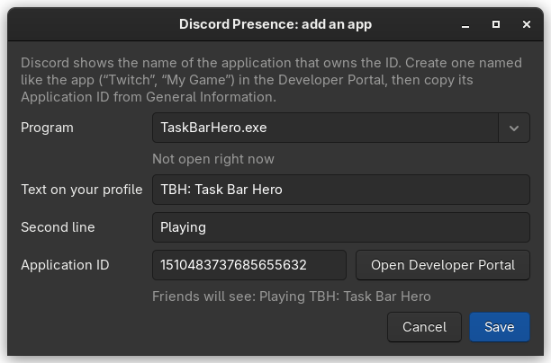

# Discord Arrpc Detector KDE

**Rich Presence do Discord para os jogos e apps que o Discord ignora no Linux:**
jogo nativo, jogo sob Proton, Counter-Strike 2 com mapa e placar, servidor do
Minecraft, série no Stremio, YouTube, YouTube Music, Twitch, Netflix,
Crunchyroll e Spotify no navegador, e qualquer programa que você apontar. Em
vez de esperar suporte, o daemon procura os processos e **fala o protocolo IPC
do Discord direto**.

[English](README.md) · [Releases](https://github.com/gabrielmf1998/Discord-Arrpc-Detector-KDE/releases) · [Relatar um problema](https://github.com/gabrielmf1998/Discord-Arrpc-Detector-KDE/issues/new/choose) · [Espelho no GitLab](https://gitlab.com/gabriel17166/discord-arrpc-detector-kde)

Python puro (só biblioteca padrão), roda como serviço systemd de usuário e
sobe sozinho no boot. Sem Node, sem arRPC oficial, sem plugin do Vencord.

Vem com um **ícone de bandeja** (GTK3 + AppIndicator, nada de Qt): quais apps
o Discord enxerga, aparência do ícone, início automático, tudo pelo menu. A
única janela é a de adicionar um app seu, porque um menu não recebe texto.



---

## O problema

O Discord detecta jogos comparando os processos abertos com a base pública de
jogos detectáveis (`https://discord.com/api/v9/applications/detectable`). No
Linux essa base falha de várias formas ao mesmo tempo:

| Situação | O que a base traz | Resultado |
|---|---|---|
| RuneScape nativo (`rs2client`) | só executáveis `win32` e `darwin` | nunca detecta |
| GTA SA sob Proton (`gta-sa.exe`) | executável `win32` | o processo tem caminho Wine, não bate |
| TBH: Task Bar Hero | **nenhum** executável cadastrado | nunca detecta |
| Stremio, YouTube, Twitch, Netflix... | não existem na base | nunca detecta |

Este projeto resolve pelo outro lado: eu digo qual processo é qual app, e o
daemon publica a presença.

## O que ele mostra

| App | Como detecta | O que aparece |
|---|---|---|
| **Counter-Strike 2** | processo `cs2` + Game State Integration da Valve | modo e mapa ("Competitivo · Mirage"), **placar do seu time**, seu K/A/D, aquecimento, fim de partida |
| **RuneScape 3** | processo `rs2client` | "Gielinor" |
| **Minecraft** (Prism, MultiMC, Flatpak) | `java` da instância | nome da instância, **servidor conectado** (o nome que você digitou, lido do log do jogo) e **lotação** (ex.: `860 of 5000`) |
| **Left 4 Dead 2** | `hl2_linux -game left4dead2` ou `left4dead2.exe` no Proton | **campanha e capítulo** ("Dark Carnival — capítulo 3") |
| **GTA: San Andreas** | memória do processo | **bairro, veículo, vida, dinheiro**, estrelas de procurado e "Em missão" |
| **TBH: Task Bar Hero** | `TaskBarHero.exe` sob Proton | "Jogando" |
| **Roblox** (Sober) | processo `sober` | **nome da experiência**, criador, ícone e quantos estão jogando |
| **Stremio** (nativo ou Flatpak) | processo + MPRIS | **série — episódio** ("Prison Break — Unearthed (2x9)") |
| **YouTube** (Firefox, Chrome, Chromium, Brave, Vivaldi, Edge) | MPRIS + a aba do navegador | **título e canal** com link, miniatura do vídeo, progresso, "pausado em 3:21", **"🔴 Ao vivo"**, **Shorts**, **"Anúncio"**, e o que você navega sem vídeo ("Na página inicial", "Pesquisando", "No canal Blender", "Nas inscrições") |
| **YouTube Music** (os mesmos navegadores) | MPRIS + a aba do navegador | **faixa e artista** com link, capa, progresso, pausado, anúncio, e a página aberta ("Na biblioteca", "Explorando") |
| **Twitch** | MPRIS + a aba do navegador | **canal** e título da live, com link |
| **Netflix**, **Crunchyroll** | MPRIS + a aba do navegador | o que está passando (quando a página diz), pausado, progresso |
| **Spotify Web** | MPRIS + a aba do navegador | **faixa e artista**, capa, progresso |
| **Claude Code** | nome do executável | "Programming" e o tempo de sessão, nada além disso |
| **Qualquer outro** | janela **Add your own app** da bandeja | seu texto, seu Application ID |

Twitch, Netflix, Crunchyroll e Spotify não estão na base do Discord: cada um
precisa de um app seu no Developer Portal (veja
[Sites que pedem o seu Application ID](#sites-que-pedem-o-seu-application-id)).
Até lá ficam desligados.

Adicionar um app novo é escolher no menu da bandeja, ou editar um JSON —
nenhuma linha de código. Veja [O ícone de bandeja](#o-ícone-de-bandeja) e
[Adicionar seus próprios apps](#adicionar-seus-próprios-apps).

---

## Instalação

### Pacote pronto

Baixe da [página de releases](https://github.com/gabrielmf1998/Discord-Arrpc-Detector-KDE/releases):

| Distro | Arquivo | Comando |
|---|---|---|
| **Fedora**, RHEL, Nobara | `.rpm` | `sudo dnf install ./discord-game-presence-*.noarch.rpm` |
| **Debian**, Ubuntu, Mint, Pop!_OS | `.deb` | `sudo apt install ./discord-game-presence_*_all.deb` |
| **Arch**, Manjaro, EndeavourOS, CachyOS | `.pkg.tar.zst` | `sudo pacman -U ./discord-game-presence-*-any.pkg.tar.zst` |
| Qualquer outra | `.AppImage` | `chmod +x DiscordPresence-*.AppImage && ./DiscordPresence-*.AppImage` |

Cada release é testada no Arch, Ubuntu 24.04 e 26.04, Debian 13, Fedora e openSUSE Tumbleweed, pelo script e pelo pacote, e numa VM Ubuntu de verdade. Veja a [matriz de testes](docs/TESTING.md).

Depois, uma vez, sem root:

```bash
systemctl --user enable --now discord-game-presence.service
systemctl --user enable --now discord-game-presence-tray.service
```

O `.AppImage` carrega o código do projeto mas usa o **Python e o GTK do
sistema** — empacotar GTK inteiro passaria de 100 MB e ainda quebraria a
integração com o tema de ícones do desktop, que é justamente o que a bandeja
usa. Ele aceita `./DiscordPresence-*.AppImage daemon` para rodar só o daemon e
`install` para copiar tudo para `~/.local/bin`.

### Script (instala também o Vesktop)

Qualquer distro com systemd. Rode como usuário normal; o `sudo` só aparece se
faltar alguma dependência ou o Vesktop.

```bash
curl -fsSL https://raw.githubusercontent.com/gabrielmf1998/Discord-Arrpc-Detector-KDE/main/install.sh | bash
```

As opções vão **depois do pipe**, no `bash` (antes do `curl` elas não chegam
ao instalador):

```bash
URL=https://raw.githubusercontent.com/gabrielmf1998/Discord-Arrpc-Detector-KDE/main/install.sh
curl -fsSL "$URL" | SKIP_VESKTOP=1 bash       # já usa outro cliente com o socket de IPC
curl -fsSL "$URL" | SKIP_TRAY=1 bash          # sem o ícone de bandeja
curl -fsSL "$URL" | DGP_VERSION=1.4.0 bash    # uma versão específica
```

Tudo pelo espelho no GitLab, script e release:

```bash
curl -fsSL https://gitlab.com/gabriel17166/discord-arrpc-detector-kde/-/raw/main/install.sh | DGP_MIRROR=gitlab bash
```

O instalador:

1. detecta a distro (Arch, Debian/Ubuntu, Fedora, openSUSE, ou genérica);
2. instala só as dependências que faltarem (`python3`, `iproute2`/`ss`,
   `curl`, PyGObject, GTK3, AppIndicator, librsvg); com tudo presente, nem
   pede senha;
3. instala o **Vesktop nativo** se ele ainda não existir: `.deb`/`.rpm`
   oficial do Vesktop no Debian, Fedora e openSUSE, pacote dos repositórios
   oficiais no Arch quando houver, e o tarball oficial em `/opt` nos demais
   casos (o AUR nunca é usado);
4. baixa o daemon, a bandeja e as duas units da **última release**, confere o
   sha256 de cada um com o `SHA256SUMS` dela e só então instala em
   `~/.local/bin` e `~/.config/systemd/user`, com os dois serviços ligados;
5. liga o log de console do L4D2, necessário para saber o mapa.

Rodar o mesmo comando de novo **atualiza**: a versão anterior fica em
`~/.local/share/discord-game-presence/backup/<versão>/` e daemon e bandeja
reiniciam com a nova. Depois da primeira instalação, a própria bandeja avisa
das próximas versões (menu **Updates**).

Prefere clonar: `git clone` + `./install.sh` faz o mesmo com os arquivos do
clone, do GitHub ou do GitLab.
Passo a passo manual, sem script: [`INSTALAR.txt`](INSTALAR.txt).

### Por que Vesktop nativo

O daemon precisa do socket `$XDG_RUNTIME_DIR/discord-ipc-N`. Vesktop nativo
(`.deb`/`.rpm`/pacote da distro) e o Discord nativo criam o socket no runtime
dir real do usuário, que é o caminho mais simples.

O Discord do Flathub também serve: o `discord.sh` dele repassa o socket para
`$XDG_RUNTIME_DIR/app/com.discordapp.Discord/discord-ipc-0`, e o daemon procura
nessas pastas sozinho. O Vesktop em Flatpak não expõe o socket para fora da
sandbox. Um socket velho, de um cliente que caiu, é pulado em vez de prender o
daemon nele.

---

## O ícone de bandeja

O menu é a interface. Ele fala com o systemd, com o arquivo de configuração e
com o próprio catálogo do daemon. A única janela é a de **Add your own app**.

| Menu | O que faz |
|---|---|
| **Daemon: running/stopped/paused** | estado do serviço, no topo |
| **Showing now:** | o que o Discord recebeu de fato, dito pelo próprio daemon (não um palpite da bandeja) |
| **Discord: Vesktop ready** | qual cliente está recebendo o Rich Presence. Sem socket aparece **⚠ Discord not found** ou **⚠ Vesktop has Rich Presence off**, e **How to fix this** explica a opção exata (no Vesktop: Settings, Vesktop Settings, Rich Presence) |
| **Pause presence** | 15 minutes, 1 hour, 4 hours ou Until I resume: apaga tudo do perfil e segura o daemon até a hora. Vale também depois de reiniciar o PC. **▶ Resume presence** volta na hora |
| **Apps Discord can see** | liga e desliga cada app do catálogo; marca com `• showing` o que está publicado agora (`• open` quando o daemon está parado) |
| ↳ **Add your own app…** | a janela do print: escolha um programa aberto, escreva o texto e cole um Application ID. Ela confere o ID com o Discord e mostra "Friends will see: Playing *nome*" antes de salvar |
| ↳ **Edit an app** | muda um app que você adicionou, ou o Application ID de um site |
| ↳ **Add a running app** | varre os processos abertos, cruza com a base de jogos detectáveis do Discord e adiciona o que reconhecer, em um clique, com o Application ID e o ícone certos. Usa as mesmas regras do arRPC (pedaços do caminho, entradas de launcher ignoradas, argumentos exigidos como palavras inteiras, então `-game hl2` não casa com `-game hl2mp`), com duas proteções a mais: um nome que vários jogos usam (`game.exe`, `client.exe`) só vale se um pedaço maior do caminho desempatar, e jogos nativos (`Unturned.x86_64`) casam com o `.exe` da base quando o nome é de um jogo só. Wrappers do Proton e processos do Wine (`C:\windows\…`) nunca viram sugestão. A varredura roda num processo à parte, que devolve a memória quando sai |
| **Presence details** | um submenu por app com o que os amigos veem: o nível (tudo, sem nada clicável, só o nome do app), capa, links, botões, tempo e, nos apps de mídia, pausa, anúncios, navegação e busca. Vale na hora, sem reiniciar o daemon, então a presença não some do perfil. Veja [O que cada app mostra](#o-que-cada-app-mostra) |
| ↳ **Remove an app I added** | tira do catálogo o que você adicionou |
| ↳ **Enable all / Disable all** | tudo de uma vez |
| **Appearance → Icon shape** | nove desenhos próprios: Blob, Controller, Broadcast, Bolt, Chat, Headset, Rocket, Ghost, Dot |
| **Appearance → Icon from desktop theme** | usa o ícone do tema do sistema (Breeze, no KDE): Discord, Vesktop, Games, Gamepad… — para o ícone combinar com o resto do painel |
| **Appearance → Color** | 15 cores com hex (paleta do Discord + Breeze/Plasma + neutras) e **Match KDE accent**, que lê a cor do seu esquema atual |
| **Daemon → Start at boot** | `systemctl --user enable` do daemon |
| **Daemon → Start tray at login** | o mesmo para a bandeja |
| **Daemon → Clear stuck presence** | manda o Discord apagar qualquer presença pendurada |
| **Daemon → Reload catalog / View log** | recarrega o catálogo; abre o journal em um terminal |
| **Configuration** | mostra o caminho do JSON, abre o arquivo, abre a pasta, copia o caminho |
| **⬆ Update to X** | aparece no topo quando sai versão nova; um clique baixa, confere e instala |
| **Updates** | versão instalada e o tipo de instalação, **Check for updates now**, o modo (instalar sozinho, só avisar, nunca procurar) e **Release notes** |
| **Report a problem** | abre uma issue no GitHub já preenchida com versão, distro, desktop, cliente do Discord e as últimas linhas do log, ou copia o mesmo relatório para o GitLab ou um chat. Títulos, links, textos entre aspas e a pasta pessoal saem antes; nada é enviado até você clicar em **Create** |
| **Start/Stop/Restart daemon**, **Quit tray** | controle direto |

O ícone fica **acinzentado quando o daemon está parado** e colorido quando
está rodando, então dá para ver o estado sem abrir o menu. As preferências
ficam em `"tray"` dentro do mesmo `~/.config/discord-game-presence.json`.

Ele roda pelo serviço `discord-game-presence-tray.service`, ligado à sessão
gráfica. Para instalar sem a bandeja: `SKIP_TRAY=1 ./install.sh`.

### Atualizações

A bandeja olha a última release do GitHub 45 s depois de abrir e depois a cada
6 h. Quando sai uma versão nova, chega uma **notificação** com os botões
**Update now** e **What's new**, uma vez por versão, e o item **⬆ Update to X**
fica no menu até você atualizar. Depois da troca, a bandeja nova avisa
"updated to X".

O que é baixado depende de como você instalou, e o menu **Updates** mostra qual
é o seu caso:

| Instalação | Como atualiza |
|---|---|
| `install.sh` (`~/.local/bin`) | baixa os dois scripts e as units, guarda os antigos em `~/.local/share/discord-game-presence/backup/<versão>/`, troca e reinicia daemon e bandeja. Sem senha |
| pacote `.pkg.tar.zst`, `.deb`, `.rpm` | baixa o pacote da release e instala com `pkexec` (a janela de senha do sistema) |
| AppImage | troca o arquivo `.AppImage` pelo novo |
| clone do git ou cópia à mão | só avisa e abre a página da release; nunca sobrescreve |

Nada é instalado sem conferir o **sha256** que o GitHub publica para cada
arquivo da release (ou o `SHA256SUMS` anexado). Um arquivo que não bate, um
daemon que não é da versão anunciada ou um script que não compila cancelam a
troca sem mexer no que está instalado. **Install updates automatically** só
vale para script e AppImage, que não pedem senha.

Pelo terminal: `discord-game-presence --check-update` e
`discord-game-presence --update`.

### O que cada app mostra

Cada entrada tem um nível, e os `show_*` trocam um item só. Pela bandeja em
**Presence details**, ou no JSON:

```json
{
  "games": {
    "youtube":       { "detail": "basic", "show_ads": false, "show_browsing": false },
    "youtube-music": { "show_paused": false },
    "PrismLauncher/instances": { "detail": "minimal" }
  }
}
```

| `detail` | O que vai para o perfil |
|---|---|
| `"full"` (padrão) | tudo: título, canal ou artista, capa, links nos textos, botões, barra de progresso |
| `"basic"` | o mesmo texto e a capa, sem nada clicável |
| `"minimal"` | só o app e há quanto tempo: "Assistindo YouTube", "Jogando Minecraft", sem servidor, mapa ou título |

| Campo | Padrão | Para que serve |
|---|---|---|
| `show_thumbnail` | do nível | capa do vídeo ou da música; desligado fica o ícone do app |
| `show_links` | do nível | links no título, no canal e na imagem |
| `show_buttons` | do nível | os botões "Assistir no YouTube", "Ver o canal"… |
| `show_time` | `true` | cronômetro e barra de progresso |
| `show_paused` | `true` | mídia pausada continua no perfil; `false` tira na hora |
| `pause_minutes` | `5` | por quanto tempo a mídia pausada continua no perfil |
| `show_ads` | `true` | `false` não mostra "Anúncio": fica o vídeo ou a música que vem depois |
| `premium` | `false` | `true` quando a conta tem YouTube Premium: nada vira "Anúncio" |
| `show_browsing` | `true` | `false` só mostra quando algo está tocando, nunca a página inicial ou um canal |
| `browse_minutes` | `15` | a mesma página parada por mais que isso sai do perfil |
| `show_search` | `false` | mostra o termo pesquisado ("Pesquisando blender") |

Os campos de mídia valem para `youtube` e `youtube-music`; `show_paused` e
`pause_minutes` valem também para o `stremio`. A pausa da bandeja fica em
`"pause": {"until": <epoch>}` (ou `null`, até retomar), no mesmo arquivo.

Esses campos (e `status_display`) são relidos sem reiniciar: a bandeja manda
`SIGHUP` ao daemon, e quem edita o JSON à mão usa
`systemctl --user reload discord-game-presence`. A presença é republicada na
mesma conexão. Trocar `client_id`, `match` ou `exe` ainda pede `restart`. Se o
arquivo mudar por fora, o menu da bandeja se redesenha sozinho em até 8 s.

---

## Sites que pedem o seu Application ID

O Discord mostra o **nome do app** dono do ID ("Assistindo Twitch"), então cada
site precisa de um app com o nome dele:

1. Abra <https://discord.com/developers/applications> e clique em **New
   Application**. Dê o nome `Twitch` (ou `Netflix`, `Crunchyroll`, `Spotify`).
2. Se quiser, suba um **App Icon** em General Information.
3. Copie o **Application ID**.
4. Na bandeja, **Apps Discord can see → Twitch (needs an Application ID)**,
   cole e clique em **Save**.

Como o site é reconhecido: um player MPRIS do navegador cujo título aparece numa
aba do site, ou a única página de player do site aberta; sem nada tocando, a
aba do site ativa numa janela visível conta como navegação (desliga em
**Presence details**). O Firefox informa a URL direto. O Spotify Web manda
também a capa; se a sua conta do Discord já está ligada ao Spotify, o Discord
já mostra isso, e dá para deixar essa entrada desligada.

## Counter-Strike 2

O CS2 está na base do Discord e o Vesktop já detecta pela Steam. O que este
projeto acrescenta é **o que acontece na partida**, pelo
[Game State Integration](https://developer.valvesoftware.com/wiki/Counter-Strike:_Global_Offensive_Game_State_Integration)
oficial da Valve:

* o daemon grava `game/csgo/cfg/gamestate_integration_discord_presence.cfg` em
  cada CS2 instalado (bibliotecas Steam em qualquer disco);
* o jogo manda o estado por HTTP POST para `127.0.0.1:47838`, só esta máquina,
  com um token aleatório guardado em
  `~/.local/share/discord-game-presence/cs2-token` (modo 600); POST sem ele é
  recusado;
* só `provider`, `map`, `round`, `player_id` e `player_match_stats` são pedidos.

O CS2 lê esse arquivo ao abrir. O daemon grava assim que inicia; se o CS2 já
estava aberto nessa hora, reabra o CS2 uma vez. A
presença usa o Application ID do próprio CS2, para o Discord juntar com o
"Jogando Counter-Strike 2" que o Vesktop já mostra em vez de listar o jogo duas
vezes. Outra porta: `DGP_CS2_PORT=...` no ambiente do serviço.

---

## Adicionar seus próprios apps

O jeito fácil é a janela **Add your own app…** da bandeja. O JSON abaixo faz o
mesmo e mais.

Toda a configuração vive em `~/.config/discord-game-presence.json`. O que
estiver lá é aplicado por cima da tabela padrão: entradas novas são
adicionadas, entradas existentes têm só os campos citados trocados, e um
`client_id` vazio desliga a entrada.

### 1. Descubra o Application ID

Se o jogo estiver na base do Discord, use o id de lá:

```bash
curl -s https://discord.com/api/v9/applications/detectable \
  | python3 -c 'import json,sys
for a in json.load(sys.stdin):
    if "parte do nome" in a["name"].lower(): print(a["id"], a["name"])'
```

Se **não** estiver (caso de Stremio, YouTube, e de qualquer app que não seja
jogo), crie um app seu em https://discord.com/developers/applications →
**New Application**. O nome do app é o nome que aparece no seu perfil. Suba
uma imagem em **General Information → App Icon** e copie o **Application ID**.

### 2. Descubra o processo

```bash
ps -eo comm,args | grep -i <nome do app>
```

Use o **nome do executável**: `jogo.exe` para um jogo sob Proton (o processo
dele aparece como `S:\common\Jogo\jogo.exe`), `Jogo.x86_64` ou `jogo` para
um nativo. O nome é comparado inteiro, sem diferença de maiúsculas, contra o
programa que está rodando (`argv[0]`), o `comm` do kernel, o executável real e,
quando o processo é um interpretador (`bash`, `python3`, `java -jar`, `mono`),
o script que ele carrega. `.exe`, `.x86_64`, `.x86` e `.sh` podem ficar de fora.

Por isso não contam mais como "jogo aberto" um `grep jogo.exe`, um editor
aberto no `autoexec.cfg`, um `tail -f` no log nem os wrappers do Proton
(`proton waitforexitandrun …/jogo.exe`), que só carregam o caminho nos
argumentos. Comandos de shell (`bash -c …`) também ficam de fora.

Para conferir o que o daemon está vendo, sem publicar nada:

```bash
discord-game-presence --scan      # ou ~/.local/bin/discord-game-presence.py --scan
```

Ele lista cada app do catálogo, aberto ou fechado, com o PID e o processo que
provou que está aberto, desde quando, os sockets de IPC encontrados e cada
player MPRIS com o serviço reconhecido.

### 3. Escreva a entrada

```json
{
  "games": {
    "jogo.exe": {
      "client_id": "1234567890",
      "details": "Nome do Jogo",
      "state": "Jogando",
      "large_text": "Nome do Jogo",
      "large_image": "https://exemplo/imagem.png"
    }
  }
}
```

| Campo | Para que serve |
|---|---|
| `client_id` | Application ID. Vazio desliga a entrada |
| `details` | primeira linha da presença |
| `state` | segunda linha |
| `large_text` | texto ao passar o mouse na imagem |
| `large_image` | nome de um Art Asset do app **ou** uma URL de imagem |
| `type` | `0` jogando, `2` ouvindo, `3` assistindo (veja os limites) |
| `exe` | nome do executável (ou lista); sem ele vale a chave da entrada |
| `args` | trecho(s) que também precisam estar nos argumentos, ex.: `"-game left4dead2"` |
| `cmdline` | trecho qualquer da linha de comando, o jeito antigo (editores, `grep` e `tail` não contam) |
| `match` | lista de regras alternativas, cada uma com `exe`/`args`/`cmdline` |
| `grace` | segundos de tolerância antes de apagar quando o app some (útil para mídia) |
| `status_display` | o que a lista de membros mostra depois de "Jogando/Ouvindo/Assistindo": `"name"` (o app), `"details"` (1ª linha) ou `"state"` (2ª linha) |
| `detail`, `show_*` | quanto a presença mostra; veja [O que cada app mostra](#o-que-cada-app-mostra) |

Uma chave sem `/`, `\`, `:` ou espaço é tratada como `exe`; uma com algum
deles continua valendo como trecho de linha de comando, então configs antigos
seguem funcionando. Exemplo com duas regras:

```json
"meujogo": {
  "client_id": "1234567890",
  "match": [{"exe": "meujogo_linux", "args": "-game meujogo"},
            {"exe": "meujogo.exe"}]
}
```

O **tempo de jogo** conta desde que o processo nasceu (lido de `/proc`), e
não desde que o daemon o viu: reiniciar o daemon, ligar outro app na bandeja ou
o Discord reconectar não zeram mais o cronômetro.

Depois: `systemctl --user restart discord-game-presence`.

### Trocando os apps de mídia pelos seus

Stremio, YouTube e YouTube Music vêm apontando para apps que eu criei. Para
usar os seus (com o seu ícone), basta sobrescrever o id:

```json
{
  "games": {
    "youtube":                 { "client_id": "SEU_ID" },
    "youtube-music":           { "client_id": "SEU_ID" },
    "stremio":                 { "client_id": "SEU_ID" }
  }
}
```

### Quando o JSON não basta

Presenças que mudam sozinhas — servidor do Minecraft, mapa do L4D2, faixa
tocando — são funções Python na tabela `GAMES`, dentro do
`discord-game-presence.py`. `state` e `details` aceitam qualquer callable que
devolva texto; `state` pode devolver `(texto, extras)` para mandar também
`timestamps`, `buttons`, `party` ou trocar a imagem a cada faixa. Os detectores
existentes servem de modelo.

---

## Como as detecções mais interessantes funcionam

### Minecraft: servidor e lotação

1. acha o processo `java` que leva o caminho de uma instância (Prism, MultiMC,
   PolyMC, inclusive em Flatpak) ou o main do Minecraft. Um `tail` no log ou o
   `JavaCheck.jar` do launcher não contam;
2. a pasta do jogo é o diretório de trabalho desse processo; o nome da
   instância sai do `instance.cfg` (o nome que o launcher mostra, não a pasta);
3. lista as conexões TCP estabelecidas com `ss -tnp`, descartando as de HTTP(S)
   (login, skins, atualização de mod), que antes podiam virar "o servidor";
4. o nome vem do `logs/latest.log`, onde o próprio jogo escreve
   `Connecting to <host>, <porta>`: é o endereço que você digitou, inclusive
   quando o servidor usa registro SRV e o IP conectado não bate com ele.
   Servidores de LAN e ZeroTier também aparecem. Sem essa linha, vale o
   `servers.dat` casado por DNS (com cache), e por último o IP;
5. faz um **Server List Ping** (handshake + status do protocolo Minecraft) no
   IP e porta realmente conectados, com o nome do servidor no handshake, para
   pegar `online`/`max`;
6. publica como `party.size`, que o Discord escreve como "(860 of 5000)".

### Left 4 Dead 2: mapa

O L4D2 não expõe o mapa em processo, socket ou arquivo aberto — mapas oficiais
moram dentro de VPKs. A única fonte é o console. O instalador escreve
`con_logfile "console.log"` em `left4dead2/cfg/autoexec.cfg`, e o daemon lê o
fim do log, traduzindo `c2m3_coaster` → "Dark Carnival — capítulo 3".

> O log só passa a existir **depois de reiniciar o jogo** uma vez.

### GTA San Andreas: lendo o jogo por dentro

O jogo carrega em endereço fixo (`0x400000`, sem ASLR), então o estado sai de
`/proc/<pid>/mem`: ponteiro do jogador em `0xB6F5F0`, posição pela matriz da
entidade, vida em `+0x540`, dinheiro em `0xB7CE54`, veículo em `+0x58C`.

Os **nomes vêm do próprio jogo**, não de uma tabela embutida aqui: o
`data/info.zon` diz que zona cobre cada coordenada — vale a menor caixa que
contém o ponto, senão sai "Los Santos" no lugar de "Ganton" — e o
`text/american.gxt` traduz o código dela. O GXT indexa por **CRC32 invertido**
(JamCRC) do nome da chave, o que dá para confirmar testando contra chaves
conhecidas. O mesmo caminho nomeia os veículos, via `data/vehicles.ide`. Como
tudo sai dos arquivos do jogo, a presença acompanha o idioma instalado.

"Em missão" vem de `$ONMISSION`, a variável global `$26` do script. O endereço
não foi copiado da internet: `tools/gta-calibrar-missao.py` fotografa as
variáveis fora e dentro de uma missão e mostra quais foram de 0 para 1 — de
380 candidatos sobraram dois, e um deles é o `$26` conhecido.

Nada disso altera o jogo: só leitura.

### Claude Code: só que está aberto

A detecção compara o **nome do executável** (`comm`), não a linha de comando:
os argumentos carregam o nome da sessão (`-n ...`), e nada do que está sendo
feito deve virar presença. O texto é fixo — "Claude Code" e "Programming" —
então não vazam diretório, projeto nem conversa; só que há uma sessão aberta e
há quanto tempo.

### Navegador e Stremio: MPRIS

Tudo vem do D-Bus (`org.mpris.MediaPlayer2`), lido com `busctl`, numa chamada
`GetAll` por player: metadados, estado e posição saem do mesmo instante. O bus
name do Firefox muda a cada boot e cada aba com mídia vira um player, então a
escolha é **pela URL da aba**, não pelo nome. É assim que YouTube e YouTube
Music não se confundem, e quando duas abas do mesmo serviço existem, a que está
tocando ganha da pausada.

O Firefox põe a URL no MPRIS (`xesam:url`). **Chrome, Chromium, Brave, Vivaldi
e Edge não põem**: publicam só título, canal e duração, um player por janela
do navegador. Para eles o daemon descobre a aba assim, tudo só leitura e sem
extensão:

1. **Abas abertas**: o arquivo de sessão do perfil (`Sessions/Session_*`, o
   mesmo que o navegador usa para reabrir as abas) diz a URL, o título e qual
   aba está selecionada em cada janela. O navegador grava esse arquivo uns
   2,5 s depois de cada navegação.
2. **Janelas**: o KWin, pelo D-Bus, diz o título de cada janela do navegador
   (que é o título da aba ativa) e se ela está minimizada. Isso dá o título
   atual mesmo quando o arquivo de sessão ainda tem o antigo, que é o que
   aparece em "No canal Blender".
3. **Conferência**: o título que o player toca é comparado com o do vídeo da
   URL (oEmbed do YouTube). Se não bate, é anúncio, ou a aba ainda não foi
   gravada: o daemon espera 5 s segurando o que já mostrava e só depois
   publica "Anúncio". Na troca de faixa do YouTube Music isso evita mostrar
   a capa e o link da música anterior.
4. **Histórico** (`History`, como antes) fica de reserva, para quando o arquivo
   de sessão não serve.

Um player novo só é atribuído a uma aba que esteja selecionada numa janela
visível e seja a única candidata: som de outro site não vira YouTube. Nada das
abas vai para o Discord além do que já está na presença. O Chrome informa a
posição sempre, então a barra de progresso fica exata; numa live ele informa
duração infinita, e o daemon mostra "🔴 Ao vivo" com o tempo assistido.

Sem vídeo tocando, a aba do YouTube ou do YouTube Music selecionada numa janela
não minimizada vira **navegação** ("Na página inicial", "Pesquisando", "Na
playlist X", "Nas inscrições"...), por até 15 min na mesma página. O termo
pesquisado **não** aparece por padrão; para mostrar, ligue `show_search`
(veja abaixo).

Os links clicáveis (no título, no canal e na imagem) e a linha da lista de
membros ("Assistindo Big Buck Bunny" em vez de "Assistindo YouTube", campo
`status_display`) são campos que o Discord documenta desde 2025. Um cliente
que recuse esses campos recebe a mesma presença sem eles, automaticamente.

Links de vídeo em qualquer formato dão a miniatura e o botão: `watch?v=`,
`youtu.be/`, `/shorts/`, `/live/` e `/embed/`. Uma troca de faixa ou o autoplay
derrubam o player por um instante; as entradas de mídia têm 10 s de tolerância
(`grace`) antes de apagar, para a presença não piscar.

O Firefox informa a posição **em rajadas**: publica por um tempo depois de um
seek ou de uma troca de vídeo — quando a página chama `setPositionState` — e
depois volta a `0`. Nunca publica `mpris:length`.

Por isso o tempo funciona assim:

- **Leitura real disponível**: barra de progresso verdadeira, `1:23 / 13:43`.
- **Entre as rajadas**: o daemon segue a partir da última leitura real, por até
  10 minutos. Um seek faz o Firefox reportar de novo, o que corrige a conta
  sozinho.
- **Sem nenhuma leitura real**: nenhum número. A duração do vídeo vai para o
  texto (`TGG · 13:43`), porque um cronômetro correndo ao lado do título parece
  a posição do vídeo e estaria sempre errado.

Instalar a extensão **Plasma Browser Integration** no Firefox (ou assistir pelo
Chromium) dá a barra sempre certa: esses publicam um player MPRIS com posição
de verdade, e o daemon procura o mesmo título neles antes de desistir.

A duração, quando existe, fica em cache por faixa e, para vídeo do YouTube,
pode ser lida da própria página (`lengthSeconds`, que aparece só depois de
~1 MB de HTML).

Capa: o Firefox não publica `mpris:artUrl` utilizável, então a arte vem da
miniatura do vídeo quando a URL traz o id, ou da busca do iTunes por
artista + título no caso do YouTube Music.

---

## Limites conhecidos

- **Ouvindo e Assistindo dependem do cliente.** Conferido em 2026-11-17 no
  Vesktop 1.6.9: a resposta do Discord ao `SET_ACTIVITY` devolveu `type` 3
  (YouTube) e 2 (YouTube Music), com `details_url`, `state_url`, `large_url` e
  `status_display_type` intactos. Clientes antigos respondiam com `type: 0`
  ("Jogando") ou recusavam os campos novos; nesse caso a presença sai sem os
  links, sozinha.
- **Botões não aparecem para você mesmo**, só para quem vê seu perfil.
- **Stremio não publica posição**, então não há progresso real do episódio — o
  cronômetro reinicia a cada título novo.
- Mídia **pausada por mais de 5 minutos** sai do perfil: uma aba de vídeo
  pausada continua sendo um player enquanto existir, e a presença ficava
  pendurada dizendo "(pausado)" por horas. Volta sozinha ao dar play. O tempo
  muda em `pause_minutes`, e `show_paused: false` tira na hora.
- Página de canal do YouTube não traz id de vídeo: sem miniatura nesse caso.
- No Chrome e nos outros Chromium, aba anônima não conta (não entra no arquivo
  de sessão). Um vídeo novo pode levar uns 5 s para aparecer, o tempo de o
  navegador gravar a aba.
- O Chrome expõe **um** player por instância. Com dois vídeos tocando ao mesmo
  tempo em abas diferentes ele alterna qual deles informa, e a presença segue.
- O nome da janela vem do KWin. Fora do Plasma a navegação usa só o arquivo de
  sessão, cujo título pode estar velho: aparece "Num canal" em vez do nome.
- O daemon consulta `youtube.com/oembed` e `i.ytimg.com` com o id do vídeo que
  já vai na presença, para conferir o título e escolher a miniatura.
- O Vesktop detecta sozinho os jogos que a base do Discord conhece, com a opção
  de Rich Presence (`arRPC`) ligada, que é o padrão. Desde a 1.6.9 ele usa um
  módulo nativo próprio ([Vencord/GameDetection](https://github.com/Vencord/GameDetection))
  que reconhece **todo jogo aberto pela Steam pelo AppId** (`reaper SteamLaunch
  AppId=N`, cruzado com `third_party_skus` da base), além de jogos nativos e do
  Wine pelo executável. Por isso este projeto não repete a detecção da Steam:
  ele cuida do que o Vesktop não sabe (o que toca no navegador, Stremio,
  servidor do Minecraft, mapa do L4D2, bairro do GTA, placar do CS2). Se o
  mesmo jogo aparecer duas vezes no perfil, desligue a entrada dele na bandeja.
- O link do artista no YouTube Music leva à **busca**, porque o MPRIS não traz
  o canal.

---

## Operação

```bash
systemctl --user status  discord-game-presence          # estado
systemctl --user reload  discord-game-presence          # relê as opções de exibição, sem reconectar
systemctl --user restart discord-game-presence          # após trocar apps, client_id ou match
journalctl --user -u discord-game-presence -f           # log ao vivo
systemctl --user restart discord-game-presence-tray     # a bandeja
```

Pela bandeja, os mesmos comandos estão em **Daemon** e no rodapé do menu.

Uma thread por app, cada uma esperando o processo aparecer (a lista de
processos é lida uma vez a cada 2 s e dividida entre todas, ~3 ms). Um app
aberto é conferido a cada 2 s, então fechar o jogo tira a presença do perfil em
cerca de 2 s; o texto da presença é atualizado no ritmo de cada app (5 a 15 s).
Se o Discord estiver fechado ou o socket cair, a thread tenta de novo no ciclo
seguinte. O serviço tem `Restart=always`.

A conexão também é conferida enquanto nada muda. O Vesktop 1.6.9 fecha todas
as conexões de Rich Presence quando a janela recarrega ("Renderer reloaded"), e
ao sair ou reiniciar a conexão simplesmente acaba; antes, com o jogo parado no
mesmo estado, a presença sumia do perfil até alguém reiniciar o daemon. Agora
o fim da conexão, ou um socket novo no mesmo caminho, é notado em até 2 s e a
presença volta em uns 7 s, sozinha. Se o Discord recusar uma atividade, o
motivo vai para o log e ela é tentada de novo depois de 30 s, dobrando até
10 min (o Vesktop também recusa por falha passageira, como "Request has been
terminated"). E a mesma atividade é reenviada a cada 5 min, sem mudar nada
para quem vê, para o caso de o cliente perdê-la sem avisar.

O Discord mantém a última atividade publicada mesmo depois que a conexão
morre — sem cuidado, fechar o app deixaria a presença pendurada com o
cronômetro correndo. Por isso o daemon apaga **ao ser encerrado**
(`SIGTERM`/`SIGINT`) tudo o que publicou, e **ao iniciar** apaga só o que uma
execução anterior deixou no perfil: o arquivo de estado abaixo diz o quê, e
depois de uma saída limpa não sobra nada para apagar. Nunca publica um estado
genérico quando o player já sumiu. Se algo ficar preso, **Clear stuck
presence** na bandeja apaga todos os apps do catálogo.

Isso importa porque o Discord segura quem reconecta logo em seguida com o
mesmo Application ID. Medido no Vesktop 1.6.9, a primeira reconexão rápida
passa em menos de 1 s, a seguinte espera uns 7 s e a próxima chega a 15 s.
Antes, um `restart` apagava os ~10 IDs do catálogo na saída e de novo na
entrada, e a presença sumia do perfil por quase 30 s; agora são poucos
segundos, e trocar uma opção não reconecta nada.

O que está publicado fica em `$XDG_RUNTIME_DIR/discord-game-presence/status.json`
(pasta que só o seu usuário lê). É dali que a bandeja tira o **Showing now**,
em vez de repetir a detecção inteira a cada 8 s.

## Desinstalar

```bash
systemctl --user disable --now discord-game-presence
rm ~/.local/bin/discord-game-presence.py
rm ~/.config/systemd/user/discord-game-presence.service
rm -f ~/.config/discord-game-presence.json
systemctl --user daemon-reload
```

## Arquivos

```
discord-game-presence.py                   o daemon
discord-presence-tray.py                   o ícone de bandeja (GTK3, sem Qt)
install.sh                                 instalador multi-distro
INSTALAR.txt                               instalação manual, passo a passo
docs/config.exemplo.json                   modelo de configuração
tests/test_detection.py                    testes (python3 -m unittest discover -s tests)
tests/test_options.py                      níveis de detalhe, pausa, arquivo de estado, sugestões
tests/test_update.py                       atualização contra um GitHub falso
tests/test_link.py                         conexão que o Discord fecha ou troca, recusa passageira
tests/e2e_fake_discord.py                  ponta a ponta com um Discord falso, isolado em bwrap
tests/test_sites_cs2.py                    Twitch, Netflix, Crunchyroll, Spotify e o CS2
tests/test_tray_report.py                  estado do Discord e o relatório sem dados pessoais
tests/e2e_install.sh                       o instalador via curl | bash contra uma release local
.github/workflows/ci.yml                   testes a cada push; pacotes e release a cada tag
systemd/*.service                          units para instalação por usuário
packaging/build.sh                         gera .rpm, .deb, .pkg.tar.zst e .AppImage
packaging/rpm|arch|appimage|files/         spec, PKGBUILD, AppRun e units de /usr
```

### Testes

```bash
python3 -m unittest discover -s tests          # regras, YouTube, sites, CS2, abas, IPC, opções, atualização, relatório
bwrap --ro-bind / / --dev /dev --proc /proc --unshare-pid --unshare-net \
      --tmpfs /run/user/$(id -u) --tmpfs /tmp --die-with-parent \
      python3 tests/e2e_fake_discord.py        # o daemon inteiro contra um Discord falso
bwrap --ro-bind / / --dev /dev --proc /proc --unshare-pid --unshare-net \
      --tmpfs /run/user/$(id -u) --tmpfs /tmp --die-with-parent \
      bash tests/e2e_install.sh                # o instalador, como curl | bash
```

O segundo roda o daemon de verdade contra um socket de IPC falso, sem ver o
Discord real nem a rede, e confere a detecção, o tempo de jogo, a volta para a
presença sem links quando o Discord recusa os campos novos, a presença
apagada ao fechar, o arquivo de estado, a pausa, o nível `minimal` e o
`SIGHUP`, que troca as opções sem reconectar, e a volta sozinha depois de o
Discord fechar todas as conexões, como o Vesktop faz ao recarregar.

O terceiro passa o `install.sh` pelo pipe, como o `curl`, contra uma release
servida localmente, com `HOME` temporário e `systemctl`/`sudo` de mentira:
sha256 conferido, reinício dos serviços, nenhum `sudo` com as dependências
presentes, backup ao reinstalar e recusa de uma release adulterada.

### Gerar os pacotes

```bash
packaging/build.sh              # tudo o que a máquina permitir
packaging/build.sh rpm deb      # só alguns formatos
```

Sai em `dist/`. Não precisa de root, e a máquina que constrói não precisa ser
da mesma distro do pacote — `.rpm`, `.deb` e o do pacman são árvores de
arquivos com metadados. O `.AppImage` baixa o `appimagetool` na primeira vez.

`dist/` também recebe os arquivos da instalação por script
(`discord-game-presence.py`, `discord-presence-tray.py` e as duas units) e o
`SHA256SUMS` de tudo. É de lá que a atualização pela bandeja baixa cada tipo
de instalação.

Desde a 1.5.0 a release não depende de nenhum PC: o GitHub Actions roda os
testes a cada push, e uma tag `vX.Y.Z` (igual ao `VERSION` do daemon) constrói
todos os pacotes, confere e publica a release com todo o `dist/`. O passo a
passo, com o GitLab, está em [`docs/RELEASING.md`](docs/RELEASING.md).

## Licença

[MIT](LICENSE).
